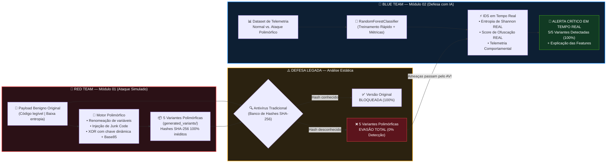

# ⚔️ AI Cyber Duel — IA na Cibersegurança (Ataque vs. Defesa)

> **Seminário Universitário — Disciplina de Sistemas de Segurança**
>
> *"Como cibercriminosos usam inteligência artificial para criar malwares polimórficos e como analistas usam a mesma tecnologia para detectar invasões em tempo real."*

[](https://github.com/victorherculini/ai-cyber-duel)
[](https://www.python.org/)
[](https://scikit-learn.org/)
[](https://github.com/Textualize/rich)
[](#%EF%B8%8F-instalação-e-execução-passo-a-passo)
[](https://codespaces.new/victorherculini/ai-cyber-duel)

---

## 🎯 Sobre Este Repositório (Apresentação 100% Prática)

Este repositório foi projetado para funcionar como **guia visual e laboratório executável ao vivo**, substituindo apresentações estáticas de slides. Durante o seminário, alternamos diretamente entre:

1. **Esta página no GitHub** — para explorar a teoria, a tabela comparativa e o diagrama de arquitetura.
2. **O Terminal ao Vivo (`python3 apresentar.py`)** — executando um menu de 1 tecla com simulação polimórfica, mutação real via AST, telemetria real de SO (`watchdog` + `psutil`), gráficos Dark Mode SOC (`dashboard_soc.png`) e **Arena Tática Web animada em `http://127.0.0.1:8080`**.

---

## 🧠 A Corrida Armamentista da IA na Cibersegurança

Durante décadas, a defesa cibernética dependeu de **assinaturas estáticas**: quando um malware era descoberto, analistas calculavam sua impressão digital criptográfica (como o hash **SHA-256**) e a distribuíam em bancos de dados de antivírus.

O problema atual é que **motores polimórficos e Modelos de Linguagem (LLMs)** tornaram trivial reescrever o código de um mesmo artefato em segundos:
- Variáveis e funções recebem nomes aleatórios;
- Blocos de *junk code* (código morto inofensivo) são injetados;
- O payload é criptografado com chaves dinâmicas (ex.: XOR variável + codificação/compressão).

O resultado? **O efeito avalanche das funções hash garante que uma mudança de 1 único bit gera um SHA-256 completamente novo**, tornando a defesa puramente estática cega diante de ameaças inéditas (*zero-day* polimórficos).

A resposta do **Blue Team** é usar a **mesma tecnologia (IA/Machine Learning)** para mudar o foco de **"como o arquivo se parece"** para **"como o arquivo se comporta e qual é sua estrutura estatística"** — analisando **Entropia de Shannon**, heurísticas de ofuscação e **telemetria comportamental em tempo real** (criação de processos, chamadas de API sensíveis e conexões de rede anômalas).

### ⚖️ Comparativo Direto: Defesa Tradicional vs. Defesa com IA

| Dimensão | 🛡️ Antivírus Tradicional (Assinaturas Estáticas) | 🤖 IDS / EDR com IA (Entropia + Comportamento) |
| :--- | :--- | :--- |
| **O que analisa** | Hash exato do arquivo (`MD5`, `SHA-256`) ou sequências fixas de bytes | Padrões estatísticos (Entropia de Shannon) + comportamento em execução |
| **Resistência ao Polimorfismo** | ❌ **Baixíssima** — 1 bit alterado invalida o hash | ✅ **Alta** — detecta ofuscação e comportamento anômalo mesmo com hash inédito |
| **Detecção de Zero-Day** | ❌ Precisa conhecer a amostra previamente | ✅ Generaliza padrões aprendidos para ameaças nunca vistas |
| **Taxa de Falsos Positivos** | ✅ Muito baixa (match exato) | ⚠️ Exige calibração (ex.: compactadores legítimos também têm alta entropia) |
| **Explicabilidade** | Direta ("Hash X está na blacklist") | Baseada em *Feature Importance* / XAI ("Quais sinais denunciaram o ataque") |
| **Papel na Arquitetura Moderna** | Primeira barreira rápida (barata) para ameaças conhecidas | Camada inteligente de detecção comportamental em tempo real |

---

## 🏗️ Arquitetura do Duelo (`Red Team` vs. `Blue Team`)

O diagrama abaixo resume exatamente o fluxo que executaremos ao vivo no terminal:



---

## 📂 Estrutura do Projeto

```text
ai-cyber-duel/
├── README.md                              # Guia visual da apresentação (esta página)
├── apresentar.py                          # Menu interativo de 1 tecla para apresentação ao vivo no projetor
├── arena_duel_live.py                     # Arena ao vivo (Split-Screen): AST + Watchdog + Psutil + Ensemble IA
├── visual_analytics.py                    # Gráficos Rich no terminal + exportação Dark Mode SOC (dashboard_soc.png)
├── web_arena.py                           # Arena Tática Web em localhost:8080 (Radar SOC animado + API REST nativa)
├── requirements.txt                       # Dependências Python (rich, scikit-learn, numpy, pandas, psutil, watchdog, matplotlib)
├── .gitignore                             # Ignora venv, cache, sandbox, quarentena e artefatos temporários
├── .devcontainer/
│   └── devcontainer.json                  # Fallback 1-clique para GitHub Codespaces
├── 01-red-team-polymorphic/
│   ├── README.md                          # Teoria: Polimorfismo e automação via LLMs
│   ├── ast_transform_engine.py            # Motor de mutação estrutural real via AST (for->while, shuffle, opaque predicates)
│   ├── polymorphic_simulator.py           # Gera payload original + 5 variantes polimórficas
│   └── static_av_bypass_demo.py           # Simula AV por SHA-256 (prova a evasão estática)
├── 02-blue-team-realtime-ids/
│   ├── README.md                          # Teoria: Entropia de Shannon, heurística e ML
│   ├── generate_telemetry_data.py         # Gera dataset sintético de telemetria SO/rede
│   └── train_and_detect_ids.py            # Treina RandomForest e detecta as variantes ao vivo
└── 03-live-demo-script/
    ├── PLANO_AULA_60MIN.md                # Roteiro completo cronometrado para apresentação de 1 hora (5 atos)
    ├── ROTEIRO_AO_VIVO.md                 # Roteiro resumido (30–45 min) + falas da apresentação
    └── PERGUNTAS_PROFESSOR.md             # 5 perguntas técnicas difíceis e respostas diretas
```

---

## ⚙️ Instalação e Execução Passo a Passo

Todos os scripts são 100% multiplataforma (`pathlib.Path`, UTF-8 explícito e compatibilidade total com `python3`) e podem ser executados a partir da **raiz do repositório**.

### 🐧 Opção 1: Linux Mint (Computador da Universidade — 100% sem `sudo`)

Instalação em espaço de usuário (não exige privilégios administrativos nem `apt`, com fallback automático caso `python3-venv` não venha pré-instalado):

```bash
git clone https://github.com/victorherculini/ai-cyber-duel.git
cd ai-cyber-duel
python3 -m venv .venv || (python3 -m pip install --user virtualenv && python3 -m virtualenv .venv)
source .venv/bin/activate
python3 -m pip install --upgrade pip
python3 -m pip install -r requirements.txt
python3 apresentar.py
```

> **Nota (caso o `pip` não esteja instalado no Linux Mint da sala):** execute antes de criar o ambiente virtual (também 100% sem `sudo`):
> ```bash
> curl -sS https://bootstrap.pypa.io/get-pip.py | python3 - --user
> ```
> Se o laboratório restringir downloads, use o **GitHub Codespaces** (Opção 3 abaixo) direto no navegador em 1 clique.

#### ✅ Checklist Rápido de Terminal no Linux Mint (Antes de Projetar)
- **Ative o `.venv` e verifique a versão:** `source .venv/bin/activate && python3 --version` (Python 3.10+).
- **Ajuste a fonte para o projetor:** use `Ctrl + Shift + +` (aumentar) / `Ctrl + -` (diminuir) até o cabeçalho do `apresentar.py` mostrar largura `>= 96` colunas (ideal para o Split-Screen lado a lado; abaixo disso a arena empilha automaticamente os painéis sem cortar dados).
- **Garanta suporte a cores/UTF-8:** se o terminal estiver sem cores, execute `export TERM=xterm-256color`.
- **Inicie a central de apresentação com 1 comando:** `python3 apresentar.py`.

### 🪟 Opção 2: Windows (PowerShell — Desenvolvimento e Testes)

```powershell
# 1. Clone o repositório e entre na pasta
git clone https://github.com/victorherculini/ai-cyber-duel.git
cd ai-cyber-duel

# 2. Crie e ative o ambiente virtual
python -m venv .venv
.\.venv\Scripts\Activate.ps1

# 3. Instale as dependências
python -m pip install --upgrade pip
python -m pip install -r requirements.txt
```

> **Dica no Windows:** Caso o PowerShell bloqueie a ativação do ambiente virtual, execute uma vez:
> `Set-ExecutionPolicy -ExecutionPolicy RemoteSigned -Scope CurrentUser`

### ☁️ Opção 3: GitHub Codespaces (Plano B em 1 Clique no Navegador)

Se houver qualquer restrição de rede, proxy ou permissão `sudo` no laboratório da universidade:

1. Acesse [https://github.com/victorherculini/ai-cyber-duel](https://github.com/victorherculini/ai-cyber-duel).
2. Clique no botão verde **`<> Code`** → aba **`Codespaces`** → **`Create codespace on main`**.
3. Aguarde ~1 minuto: o arquivo `.devcontainer/devcontainer.json` configura o Python 3.11 e instala automaticamente todo o `requirements.txt`.
4. Abra o terminal integrado no navegador e execute os comandos da demonstração abaixo!

---

## 🚀 Ordem de Execução da Demonstração Ao Vivo

### 🎛️ Modo Recomendado para o Projetor — Menu Interativo de 1 Tecla
Com o ambiente virtual ativado, você pode controlar toda a apresentação por um único painel interativo sem digitar comandos longos no palco:

```bash
python3 apresentar.py
```

Teclas disponíveis no menu:
- `[1]` Gerador Polimórfico Básico
- `[2]` Teste no Antivírus Tradicional SHA-256
- `[3]` Treinar e Rodar IDS Defensivo com IA
- `[4]` Motor Avançado de Mutação AST
- `[5]` Arena Ao Vivo Split-Screen (`watchdog` + `psutil` + Ensemble IA)
- `[6]` Exibir Relatório Técnico Gerado (`RELATORIO_INCIDENTE_SOC.md`)
- `[7]` Gráficos Visuais SOC (Terminal em ASCII/Unicode + `dashboard_soc.png`)
- `[8]` Arena Tática Web no Navegador (`http://127.0.0.1:8080` — Radar SOC interativo)
- `[0]` Limpar artefatos temporários e sair

*(Para ensaios rápidos sem pausas internas nos scripts, rode `python3 apresentar.py --auto`. Para conduzir uma aula/seminário completo de **50 a 60 minutos** dividido em 5 atos, siga o guia [`03-live-demo-script/PLANO_AULA_60MIN.md`](03-live-demo-script/PLANO_AULA_60MIN.md).)*

---

### Execução Individual (Linha de Comando)
Com o ambiente virtual ativado (ou no terminal do GitHub Codespaces), execute na sequência:

### Passo 1 — Red Team: Gerar Variantes Polimórficas
```bash
python3 01-red-team-polymorphic/polymorphic_simulator.py
```
*(No Windows, use `python` caso `python3` não esteja no PATH.)*

### Passo 2 — Red Team: Provar a Falha do Antivírus Tradicional (SHA-256)
```bash
python3 01-red-team-polymorphic/static_av_bypass_demo.py
```

### Passo 3 — Blue Team: Gerar Telemetria de Treinamento (Opcional — o Passo 4 também gera automaticamente)
```bash
python3 02-blue-team-realtime-ids/generate_telemetry_data.py
```

### Passo 4 — Blue Team: Treinar a IA e Detectar as Variantes em Tempo Real
```bash
python3 02-blue-team-realtime-ids/train_and_detect_ids.py
```

### Passo 5 — Red Team (Avançado): Motor de Mutação Estrutural via AST
```bash
python3 01-red-team-polymorphic/ast_transform_engine.py
```
*(Gera ondas de variantes sintaticamente mutadas via módulo `ast` — reordenação de funções, conversão `for` → `while` e predicados opacos — prontas para execução segura em `sandbox_env/`.)*

### Passo 6 — Arena Ao Vivo (Split-Screen): Telemetria Real de SO (`Watchdog` + `Psutil`) vs. Ondas AST
```bash
# Modo interativo (ideal para apresentação ao vivo no projetor)
python3 arena_duel_live.py

# Modo automático (sem pausa inicial)
python3 arena_duel_live.py --auto
```
*(Executa 5 ondas de variantes AST em `sandbox_env/`, captura eventos reais de disco com `watchdog`, I/O com `psutil` e pings loopback `127.0.0.1`, classifica com Ensemble `RandomForest + IsolationForest`, isola amostras em `quarantine/` e gera o relatório técnico `RELATORIO_INCIDENTE_SOC.md`.)*

### Passo 7 — Visual Analytics: Gráficos no Terminal + Dashboard PNG Dark Mode SOC
```bash
python3 visual_analytics.py
```
*(Plota gráficos de barras no terminal comparando Entropia de Shannon, Taxa de Detecção e Importância das Features XAI, além de gerar e abrir `dashboard_soc.png` em alta resolução com Curva ROC + Matriz de Confusão, Distribuição de Entropia e Latência por Onda AST. Use `--no-open` ou `--auto` em ambientes sem interface gráfica.)*

### Passo 8 — Arena Tática Web em `localhost` (Cyber Tower Defense / Radar SOC Animado)
```bash
python3 web_arena.py
```
*(Inicia servidor HTTP nativo em `http://127.0.0.1:8080` com fallback automático para `8081`, sem Node.js/npm, e abre o navegador automaticamente. Exibe batalha tática neon com barra de **Integridade do Servidor (`HP 100%`)**, trilhas luminosas, partículas, metamorfose visual dos pacotes (`SHA-256` + `Entropia` flutuantes), gráfico de histórico de risco no Canvas e **Modal Diff Lado a Lado (Original vs. Mutado AST)**. Atalhos na página: `[1]` Original, `[2]` Polimórfico/AST, `[3]` Misto `x4`, `[4]` Escudo IA Ligado/Desligado, `[5]` Reset, `[6]` Câmera Lenta `1.0x / 0.4x`, `[7]` Onda Massiva `x8`, `[C]` Diff de Código, `[F]` Tela Cheia e `[M]` Áudio Tático Web Audio API (mutado por padrão). Pressione `Ctrl+C` no terminal para encerrar.)*

> 💡 **Dica de Apresentação:** Cada script possui pausas interativas (`[Pressione ENTER para continuar...]`) para explicar os resultados no projetor. Para rodar sem pausas durante ensaios rápidos, adicione a flag `--auto` em qualquer comando.

---

## ⚖️ Aviso Legal e Ético (Disclaimer Educacional)

> **Uso Estritamente Acadêmico e Defensivo:**
> Este projeto foi desenvolvido exclusivamente para fins educacionais no contexto da disciplina universitária de **Sistemas de Segurança**.
>
> - **Zero código malicioso real:** Todos os artefatos gerados são scripts Python 100% benignos que apenas exibem uma mensagem de demonstração (`"Simulacao de Payload Ativo"`) ou criam arquivos fictícios isolados dentro de `./sandbox_env/` com pings exclusivamente em loopback local (`127.0.0.1`).
> - Nenhuma técnica aqui apresentada executa exploração de vulnerabilidades, persistência, escalonamento de privilégios, acesso não autorizado ou tráfego malicioso real.
> - O objetivo é demonstrar cientificamente os fundamentos matemáticos do polimorfismo (efeito avalanche de hashes e elevação de entropia) e a eficácia de modelos de Machine Learning na detecção defensiva em tempo real.
